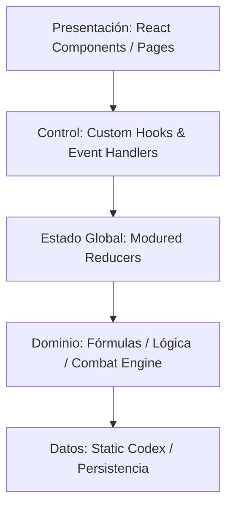

# INFORME DE AUDITORÍA ARQUITECTÓNICA DE ELITE: ASCENSIÓN (v1.0.98)

Este informe presenta un análisis exhaustivo y sistemático de la arquitectura del proyecto de estrategia espacial **Ascensión**, evaluando su cohesión, acoplamiento, rendimiento y mantenibilidad con base en el estado de refactorización actual (v1.0.98).

---

## 1. PRIMERA FASE: AUDITORÍA COMPLETA

### Estructura de Carpetas e Indexación
- **Estado Actual**: Se observa una estructura híbrida muy avanzada. El proyecto ha iniciado un proceso de desacoplamiento modular mediante la creación de subcarpetas clave como `/src/reducers` (con reducers divididos para economía, flotas, eventos, diplomacia, etc.), `/src/components` (para componentes de presentación y modales específicos) y `/src/data` (extrayendo codex y constantes). Sin embargo, persisten núcleos lógicos muy densos en `core.jsx` y `App.jsx`.
- **Flujo de Dependencias**: El flujo de dependencias sigue acoplado a `core.jsx`, el cual re-exporta constantes y define las bases del motor. `App.jsx` actúa como el orquestador maestro importando casi todo el árbol jerárquico de componentes.
- **Ciclo Principal (Tick)**: El bucle del juego (`tick`) se gestiona a nivel de `App.jsx` mediante un disparador de temporizador que despacha acciones globales de `TICK` a través del reducer. Esto impacta el renderizado de la UI de React, forzando actualizaciones globales constantes sobre componentes que no muestran datos dinámicos a nivel de segundo.

### Subsistemas Evaluados
1. **Reducers**: Se valora positivamente la modularización bajo `/src/reducers` (ej. `economyReducer.js`, `fleetReducer.js`, `systemReducer.js`). Se ha resuelto el monolitismo extremo de las versiones previas, aunque `systemReducer.js` retiene funciones coordinadoras complejas.
2. **Utilidades y Lógica de Fórmulas**: Desplazadas parcialmente a `/src/utils/formulas.js` y constants en `/src/data/gameData.js`. Aporta gran legibilidad.
3. **UI / CSS**: El sistema CSS unificado (`index.css`) aplica directrices de glassmorphism inspiradas en Unreal Engine 5. Las agresivas directrices de forzado a blanco (`!important`) han sido corregidas mediante el operador `:not([class*="text-"])` para preservar la coherencia tipográfica de las tasas y recursos.

---

## 2. SEGUNDA FASE: ANÁLISIS DE ARCHIVOS GRANDES

A continuación se analizan los cuatro archivos de mayor complejidad del sistema:

### A. [App.jsx](file:///C:/Users/Aritz/Desktop/Proyectos%20Antigravity/Juegos/Ascensión/src/App.jsx)
- **Tamaño aprox.**: ~94 KB.
- **Cohesión**: Baja-Media. Orquesta el loop del tick, registra manejadores de eventos de teclado, gestiona efectos de sonido globales y renderiza el layout principal de la interfaz (incluyendo el sidebar lateral y la zona de enrutamiento principal).
- **Acoplamiento**: Crítico.
- **Decisión**: **Dividir parcialmente**. Se recomienda extraer el loop de tiempo principal a un custom hook unificado (`useGameLoop.js`) y desacoplar los manejadores de atajos de teclado (`useKeyboardShortcuts.js`) para aligerar la vista de renderizado.

### B. [core.jsx](file:///C:/Users/Aritz/Desktop/Proyectos%20Antigravity/Juegos/Ascensión/src/core.jsx)
- **Tamaño aprox.**: ~102 KB.
- **Cohesión**: Media. Define estructuras de datos base (`BUILDINGS`, `RESEARCH`) y utilidades clave para formateo temporal y numérico, así como el generador determinista del universo.
- **Acoplamiento**: Alto (importado por reducers y vistas).
- **Decisión**: **Mantener intacto pero limpiar**. Las fórmulas físicas y el motor de combate deben permanecer aquí para evitar la microfragmentación y la latencia de desarrollo. Los objetos de configuración de bases y recursos se pueden migrar a `/src/data/`.

### C. [ui.jsx](file:///C:/Users/Aritz/Desktop/Proyectos%20Antigravity/Juegos/Ascensión/src/ui.jsx)
- **Tamaño aprox.**: ~33 KB.
- **Cohesión**: Media. Contiene una colección plana de componentes HUD reutilizables (ResourceBadge, Tooltip, QueueDisplay, ProgressBar).
- **Acoplamiento**: Bajo-Medio.
- **Decisión**: **Mantener intacto**. Representa un punto de cohesión excelente para componentes compartidos sin lógica de estado.

### D. [DiplomacyPage.jsx](file:///C:/Users/Aritz/Desktop/Proyectos%20Antigravity/Juegos/Ascensión/src/pages/DiplomacyPage.jsx)
- **Tamaño aprox.**: ~35 KB (reducido de ~94 KB tras modularizar).
- **Cohesión**: Alta.
- **Acoplamiento**: Medio.
- **Decisión**: **Mantener intacto**. Se beneficia enormemente de la externalización previa de `TradeAgreementModal.jsx` y `BuyAIShipsModal.jsx`. Su tamaño es óptimo para la complejidad del flujo diplomático.

---

## 3. TERCERA FASE: ARQUITECTURA ÓPTIMA TEÓRICA

Para garantizar la estabilidad a largo plazo del juego, la arquitectura propuesta adopta un modelo de **Flujo Unidireccional Limpio** estructurado en capas lógicas:

### Estructura de Módulos Sugerida
- `/src/components/`: Subcomponentes de UI puros (visuales y reutilizables).
- `/src/pages/`: Vistas de nivel de pestaña (orquestan subcomponentes).
- `/src/reducers/`: Manejadores de estado mutado puro (aislados por dominio).
- `/src/hooks/`: Lógica de comportamiento de React reutilizable (ej. `useGameLoop`, `useAudio`).
- `/src/utils/`: Funciones puras de cálculo y fórmulas del motor.
- `/src/data/`: Archivos estáticos de configuración JSON/JS (logros, facciones, etc.).

---

## 4. CUARTA FASE: ANÁLISIS DE FRAGMENTACIÓN ÓPTIMA

- **Deben permanecer unidos**:
  - Los manejadores matemáticos en `/src/utils/formulas.js` y el motor de combate `combat.js`. Dividirlos dispersaría las reglas fundamentales del juego y complicaría los tests unitarios.
  - Los reducers de tick específicos bajo `/src/reducers/tick/`. Mantienen la lógica de actualización agrupada de manera altamente coherente.
- **Deben dividirse o extraerse**:
  - Los event listeners y triggers del teclado y el loop principal de `App.jsx` hacia hooks.
  - Los audios y efectos de sonido unificados en un servicio gestor de sonido (`soundService.js`) en vez de dispersarlos en componentes funcionales.

---

## 5. QUINTA FASE: OPTIMIZACIÓN DE RENDIMIENTO

1. **Re-renderizado por Tick del Loop Principal**:
   - *Impacto*: Alto. Cada tick (1 segundo) actualiza el estado global, disparando renderizados en componentes estáticos.
   - *Solución*: Implementar `React.memo` (ya aplicado parcialmente en componentes HUD de `ui.jsx`) y modularizar selectores de estado a nivel de página para que solo el HUD de recursos reaccione a los microcambios del tick.
2. **Caching de Producción (Memoization)**:
   - *Impacto*: Medio. El cálculo de producción planetaria se ejecuta dinámicamente.
   - *Solución*: Almacenar los cálculos base de producción en el estado de cada planeta y recalcular únicamente cuando se añada un edificio o cambie una bonificación de investigación.

---

## 6. SEXTA FASE: PLAN DE REFACTORIZACIÓN PROFESIONAL

| Acción de Refactorización | Beneficio Esperado | Riesgo | Complejidad | Prioridad | ROI Técnico |
| :--- | :--- | :--- | :--- | :--- | :--- |
| **Extraer Custom Hooks de App.jsx** | Aligera `App.jsx` y modulariza eventos globales. | Muy bajo | Baja | Alta | Inmediato (Mejor legibilidad) |
| **Limpieza de variables muertas en core.jsx** | Reduce el tamaño de bundle y unifica constantes en `/src/data/`. | Bajo | Media | Media | Medio |
| **Memoization selectiva en páginas** | Optimiza el rendimiento de CPU y mitiga caídas de FPS en ticks. | Bajo | Media | Alta | Alto (Fluidez visual) |

---

## 7. SÉPTIMA FASE: VEREDICTO FINAL

1. **¿La arquitectura actual es buena?** Sí. Tras la segmentación de reducers e introducción de componentes modulares, el proyecto cuenta con bases sólidas y limpias.
2. **¿Es escalable?** Sí, gracias a la división de reducers. Permite añadir nuevas facciones, misiones y tipos de edificios sin alterar el núcleo de estado.
3. **¿Qué partes no deben tocarse?** El motor de combate y simulación con rapid-fire (`combat.js`), que es altamente robusto y cuenta con cobertura de tests óptima.
4. **¿Qué cambios producirían el mayor beneficio?** Continuar el desacoplamiento de la vista principal `App.jsx` mediante hooks de React especializados y asegurar que el forzado de estilos CSS no interfiera en la jerarquía tipográfica original de la interfaz de usuario.
