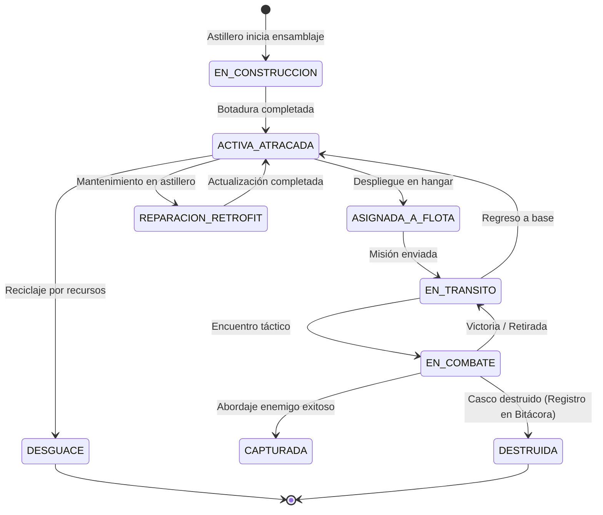
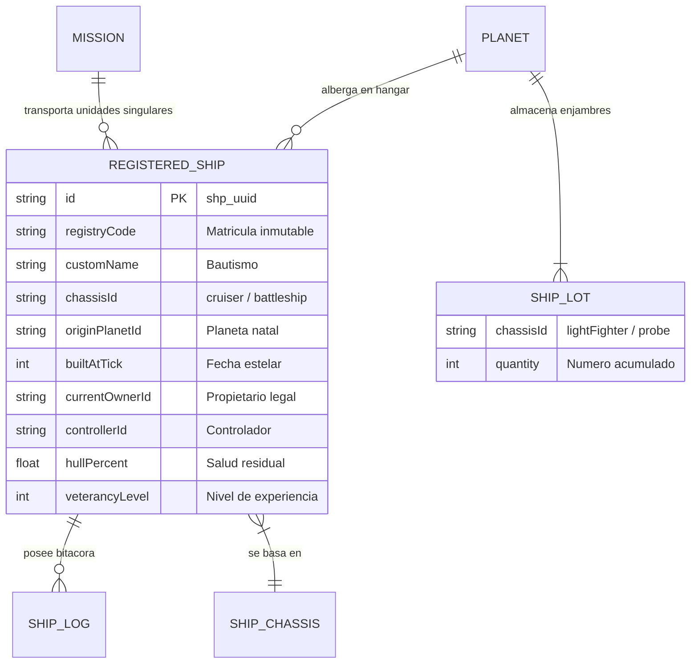

# ANÁLISIS ARQUITECTÓNICO, DISEÑO DE SISTEMAS Y VIABILIDAD: ENTIDAD INDIVIDUAL PERSISTENTE PARA NAVES (SISTEMA DE MATRÍCULA Y TRAZABILIDAD NAVAL)

---

## 1. Resumen Ejecutivo

- **Diagnóstico General**: Convertir **todas y cada una** de las naves del juego en entidades individuales completas con historial continuo e inmutable es conceptualmente muy atractivo, pero **altamente peligroso e inviable si se aplica de forma homogénea** a toda la flota en la arquitectura actual.
- **La trampa del 4X / OGame**: En *Ascensión*, el combate, la economía y la escala están diseñados para flotas masivas (cientos o miles de cazadores ligeros, sondas y cargueras). Tratar un caza ligero de usar y tirar exactamente igual que a un crucero insignia o un acorazado colosal colapsaría la persistencia local JSON (`%APPDATA%/Ascension/`), degradaría el motor de combate por turnos y generaría fatiga cognitiva inmanejable en la interfaz de usuario.
- **Solución Estratégica Óptima (Arquitectura Híbrida de 2 Niveles - "Sistema Naval Jerárquico")**:
  1. **Naves Capitales e Insignias (Clase Entidad con Matrícula / Registro de Casco)**: Cruceros, Naves de Batalla, Bombarderos, Destructores, Estrellas de la Muerte, Planetas Destructores y Naves Diseñadas a Medida (`customShips`). Cada una tiene UUID permanente, matrícula galáctica militar/civil, astillero/planeta natal, bitácora de eventos relevantes y veteranía.
  2. **Naves de Enjambre / Consumo (Clase Lote / Escuadrón)**: Cazadores Ligeros/Pesados, Sondas de Espionaje y Cargueras Pequeñas. Se mantienen como contadores agrupados o escuadrones con código de lote de fabricación, sin sobrecargar la persistencia con decenas de miles de objetos individuales muertos.
- **Veredicto de Viabilidad**: **Viable y muy enriquecedor bajo el modelo híbrido estratificado**. Inviable, redundante y desaconsejado bajo un modelo plano donde cada una de las 50.000 sondas de espionaje o cazas tenga un árbol genealógico completo en disco.

---

## 2. Estado Actual del Proyecto Relevante para Esta Idea

1. **Naturaleza del Runtime**: Juego 100% local en Windows (Electron + Vite + React + Redux/Reducer pattern). Toda la persistencia es un archivo JSON plano en `%APPDATA%/Ascension/` cargado en memoria de una sola vez.
2. **Modelo de Naves Actual (`src/data/game/shipsData.js` y `planet.fleet`)**:
   - Las naves no son instancias de objetos. Son **claves de diccionario numéricas**: `planet.fleet = { lightFighter: 45, cruiser: 10, battleship: 2 }`.
   - No existe identificación de cascos, fecha de botadura ni planeta de procedencia. Cuando 10 naves viajan del Planeta A al Planeta B, simplemente se restan números enteros en A y se suman en B al llegar (`missions.jsx: returnFleetToOrigin`).
3. **Misiones y Flotas (`fleetMissionActions.js`)**:
   - Una misión en vuelo almacena `mission.fleet: { cruiser: 5 }`. No guarda entidades individuales ni punteros; solo cantidades y referencias a los planetas `from` y `to`.
4. **Motor de Combate (`src/combat/combatEngine.js`)**:
   - Dispone de dos ramas de simulación:
     - Si `totalUnits <= 500`: Desempaqueta las naves en memoria dinámica temporal en un array plano de objetos volátiles (`units.push({ id, hull, shield, atk, alive: true })`).
     - Si `totalUnits > 500`: Agrupa por tipo de nave (`buildGroups`) para evitar bloquear el hilo de ejecución de JavaScript.
   - Las pérdidas se devuelven como recuentos enteros agregados: `atkLosses: { lightFighter: 12 }`. No hay correlación entre una nave específica y quién la derribó.
5. **Astillero y Cola de Construcción (`shipProductionActions.js`)**:
   - La cola consolida construcciones por tipo: si ya hay cazas construyéndose, incrementa `quantity` en el mismo ítem de cola en lugar de encolar piezas separadas. No guarda metadatos de serie.
6. **Persistencia y Migraciones (`loadMigrator.js`)**:
   - El savegame valida `version: 3`. Cualquier cambio que transforme `planet.fleet` de un objeto de contadores `{ id: count }` a un array de objetos rompería todas las partidas existentes a menos que se implemente una migración formal en `loadMigrator.js`.

---

## 3. Viabilidad

| Dimensión | Enfoque Plano (Todas las Naves) | Enfoque Híbrido (Capitales + Lotes) |
| :--- | :--- | :--- |
| **Persistencia JSON** | **Crítica**: Partidas tardías con 20.000 cazas multiplicarían el savegame de ~150 KB a >40 MB en JSON. Retrasos de guardado por IPC en Electron. | **Excelente**: ~200-500 naves capitales añaden apenas ~80 KB al savegame. Sin lag de I/O. |
| **Rendimiento CPU (Combate)** | **Malo**: Simular 5.000 naves individuales rastreando ID por disparo colapsaría el bucle de eventos de JavaScript (UI congelada). | **Óptimo**: El motor actual agrupa enjambres y resuelve las bajas de naves capitales por ID específico. |
| **UX y Navegabilidad** | **Inmanejable**: Un listado de 4.000 matrículas en React satura el DOM y vuelve inútil la búsqueda para el usuario. | **Premium**: Galería de Naves Capitales con insignias, filtros por rango, astillero de origen y condecoraciones. |
| **Viabilidad Global** | **NO RECOMENDADO (Inviable)** | **ALTA Y RECOMENDADA** |

---

## 4. Modelo Conceptual de una Nave como Entidad Persistente

Una nave registrada (Nave Capital / Nave Singular) no es un simple número, sino un activo imperial con ciclo de vida completo:

```typescript
interface ShipEntity {
  // 1. Identidad Permanente
  id: string;               // UUID v4 interno e inmutable (ej: "shp_8f3d1a2b-...")
  registryCode: string;     // Matrícula legible (ej: "ASC-T1-CRU-0842")
  customName: string;       // Nombre bautismal opcional (ej: "Vanguardia de Orión")
  chassisId: string;        // Tipo de nave: 'cruiser', 'battleship', 'custom_...'
  
  // 2. Procedencia y Fabricación
  origin: {
    planetId: string;       // ID del planeta donde se botó
    planetName: string;     // Nombre del planeta en el momento de fabricación
    galaxy: number;
    system: number;
    position: number;
    shipyardLevel: number;  // Nivel del astillero que la construyó
    builtAtTick: number;    // GameTick en el que concluyó su ensamblaje
    builtTimestamp: number; // Unix timestamp
    originalOwnerId: string;// Jugador o IA que ordenó la construcción
    faction: string;        // Facción de origen
  };

  // 3. Propiedad y Estado Actual
  currentOwnerId: string;   // Propietario legal legítimo
  controllerId: string;     // Quién tiene el control táctico (préstamo/captura)
  status: 'docked' | 'in_flight' | 'patrol' | 'combat' | 'captured' | 'decommissioned' | 'destroyed';
  location: {
    type: 'planet' | 'fleet' | 'orbit' | 'deep_space';
    planetId?: string;      // Si está atracada
    fleetId?: string;       // Si está asignada a una flota activa
    coordinates?: { g: number, s: number, p: number };
  };

  // 4. Estadísticas Dinámicas y Modificaciones
  condition: {
    hullPercent: number;    // Daño residual post-combate (0.0 - 1.0)
    veterancyLevel: number; // Rango o experiencia (recluta, veterana, élite)
    killsCount: number;     // Bajas confirmadas
    battlesSurvived: number;// Batallas en las que ha participado
    retrofitGeneration: number; // Nivel tecnológico aplicado
  };

  // 5. Historial Resumido (Bitácora de Casco)
  log: ShipEventLog[];
}
```

---

## 5. Identidad y Matrícula

Para evitar colisiones y garantizar inmersión:
1. **Identificador Técnico Interno**: UUID inmutable (`id`), utilizado por reducers, misiones y referencias cruzadas.
2. **Matrícula Militar Galáctica (`registryCode`)**:
   - Formato algorítmico derivado de su origen: `[FAC]-[PLN_CODE]-[CLASS]-[SERIE]`
   - Ejemplo: `HUM-P01-BAT-0042` (Facción Humana, Planeta Capital 01, Acorazado, Unidad 42).
   - Este código es permanente; aunque la nave sea capturada por corsarios o transferida a otra colonia, su matrícula original de astillero permanece grabada en el casco como número de bastidor indeleble.
3. **Nombre Bautismal (`customName`)**:
   - Asignable por el jugador para naves de rango superior (Crucero hacia arriba).

---

## 6. Procedencia

- **Datos de Alto Valor (Conservar)**:
  - Planeta natal y coordenadas de botadura.
  - Generación tecnológica / nivel de astillero en el momento de la construcción (permite saber si es una nave "antigua" o de última generación).
  - Facción/creador original.
- **Datos Redundantes (Descartar)**:
  - Coste exacto de metal/cristal gastado (ya se infiere del modelo).
  - Listado de trabajadores/población del planeta (demasiado volátil y sin valor jugable).

---

## 7. Propiedad y Control

Es imprescindible desacoplar **Propiedad Legal** de **Control Operativo**:
- **Propietario Original (`originalOwnerId`)**: Inmutable. Registro histórico del constructor.
- **Propietario Legal (`currentOwnerId`)**: Quién posee los derechos comerciales/políticos de la nave.
- **Controlador Táctico (`controllerId`)**: Quién comanda la nave actualmente.
  - En un **préstamo diplomático** o pacto de defensa mutua, el jugador A presta 3 destructores al jugador B. El controlador es B (mueve la nave y asume el coste de deuterio), pero el propietario sigue siendo A.
  - En una **captura**: Si una nave es abordada por piratas o rebeldes, el `controllerId` pasa a la IA enemiga con el flag `isCaptured: true`.

---

## 8. Ciclo de Vida

El ciclo de vida debe ser un autómata de estados finitos determinista:



---

## 9. Flotas y Agrupaciones

El mayor desafío técnico radica en la relación **Nave ↔ Flota**:
- **Problema de la modelización acoplada**: Si una nave guarda `fleetId` y la flota guarda una lista de IDs de naves, cualquier desincronización genera naves huérfanas o clonadas durante cancelaciones de vuelos o reloads.
- **Solución recomendada (Punteros Unidireccionales en Tiempo de Ejecución)**:
  - El planeta almacena el inventario de naves registradas en su hangar: `planet.registeredShips = ['shp_1', 'shp_2']`.
  - La misión en vuelo `mission` almacena explícitamente los IDs de las naves asignadas:
    ```javascript
    mission.shipRoster = ['shp_1', 'shp_2', 'shp_3']; // Naves singulares
    mission.fleet = { lightFighter: 50, smallCargo: 10 }; // Naves enjambre
    ```
  - Mientras la misión viaja, los IDs se extraen de `planet.registeredShips`. Si la flota se divide, simplemente se mueve el subconjunto de IDs a una nueva misión o de regreso al planeta.

---

## 10. Movimientos y Desplazamientos

- Las naves singulares viajan dentro del contenedor de la misión.
- Si una misión de 20 naves sufre una intercepción y el jugador decide ordenar una retirada de emergencia para sus naves dañadas:
  - Se desacoplan los IDs de las naves seleccionadas en una nueva misión de tipo `return` hacia el planeta de origen con su tiempo de vuelo recalculado en base al motor de la nave más lenta del grupo retirado.

---

## 11. Combate y Asignación de Bajas

En `src/combat/combatEngine.js`, el motor actual asigna el daño al azar contra una colección de objetivos vivos.
- **Cómo integrar naves con matrícula**:
  - En la fase de descompresión inicial, las naves singulares entran con su ID persistente (`shipRefId: 'shp_01'`).
  - Cuando un proyectil destruye una unidad con `shipRefId`, esa nave queda marcada como destruida (`isKilled = true`).
  - Al terminar las rondas de combate:
    - Las naves singulares supervivientes actualizan su daño de casco residual (`condition.hullPercent`) y suman 1 a `condition.battlesSurvived`.
    - Si destruyeron enemigos, se les incrementa `condition.killsCount`.
    - Las naves singulares destruidas no regresan al hangar: se genera un evento final de destrucción y se borran del inventario activo del planeta.

---

## 12. Capturas, Robos y Transferencias

- **Captura Táctica**: Posibilidad de que naves capitales enemigas con casco < 15% queden a la deriva en lugar de explotar, permitiendo que naves con rayos tractores o tropas de asalto las remolquen.
- **Integridad**:
  - La nave transferida o capturada **nunca muta su ID ni su matrícula**.
  - Se añade un registro a su bitácora: `Evento: CAPTURED | Antiguo Controlador: Humano | Nuevo Controlador: Corsarios de Orión | Fecha: Tick 4500`.

---

## 13. Destrucción y Limpieza de Huellas

- **Riesgo crítico de fuga de memoria / crecimiento descontrolado**: Si cada nave destruida permanece para siempre en el JSON del savegame, tras 20 horas de juego el archivo pesará megabytes de naves muertas.
- **Directiva de Eliminación / Poda**:
  - La nave destruida emite un informe al historial de batallas del jugador y se purga de la lista de naves vivas.
  - **Solo naves Legendarias o Insignias** (aquellas con rango de veterana, más de 5 victorias o Estrellas de la Muerte) conservan una ficha conmemorativa en el *Salón de Héroes Navales* del Imperio (`state.graveyard` limitado a los últimos 50 registros notables).
  - Las naves comunes destruidas simplemente alimentan el campo de escombros de la órbita (`debrisField.metal`, `debrisField.crystal`).

---

## 14. Historial y Bitácora de Casco (Eventos Relevantes)

Para evitar la sobreingeniería, la bitácora de cada nave debe ser un array circular ultracompacto (máximo 10-15 hitos de relevancia real):
1. `COMMISSIONED` (Botadura: Planeta, Tick).
2. `FIRST_BLOOD` (Primera baja confirmada).
3. `MAJOR_BATTLE` (Participación en batalla de gran escala: Sistema, Resultado).
4. `RETROFIT` (Modernización de sistemas: Nivel tecnológico nuevo).
5. `TRANSFERRED` (Venta, intercambio o captura).
6. `DECOMMISSIONED / DESTROYED` (Baja definitiva).
- **Prohibido registrar**: Cada despegue de rutina, cada cambio menor de órbita o cada tick de mantenimiento (produciría millones de entradas inútiles).

---

## 15. Modelo de Datos Conceptual



---

## 16. Escalabilidad

1. **Memoria y Almacenamiento**:
   - En una partida avanzada típica:
     - Naves de enjambre (Cazas, Sondas, Cargueros): ~5.000 a 50.000 unidades $\rightarrow$ Modelo Lote (0 sobrecoste, 1 entero en el diccionario).
     - Naves Capitales e Insignias registradas: ~50 a 300 unidades.
     - 300 objetos `ShipEntity` a ~300 bytes por objeto $\approx$ **90 KB de datos adicionales en el JSON**. Perfectamente manejable por Electron e IPC sin latencia perceptible.
2. **Consultas en UI**:
   - La vista de hangar solo debe renderizar naves registradas bajo demanda (tab "Escuadra de Capitales").
   - Uso de virtualización o paginación en React para listas de más de 50 naves.

---

## 17. Seguridad e Invariantes del Sistema

Para garantizar que no haya bugs de duplicación ni estados corruptos:
1. **Invariante de Ubicación Exclusiva**: Una nave con ID `shp_x` solo puede residir en un único lugar: o bien en `planet.registeredShips`, o bien en `mission.shipRoster`, o bien en `state.graveyard`. Jamás en dos lugares a la vez.
2. **Invariante de Despegue Atómico**: Al llamar a `SEND_FLEET`, la extracción de los IDs del planeta y su inclusión en la nueva misión debe ocurrir en la misma función reductora pura.
3. **Invariante de Cancelación Segura**: Si una misión se cancela o aborta, los IDs retornan de inmediato a `registeredShips` del planeta emisor.

---

## 18. Impacto en la Arquitectura Existente

| Módulo | Estado Actual | Modificación Requerida | Riesgo |
| :--- | :--- | :--- | :--- |
| `src/data/game/shipsData.js` | Definiciones estáticas de naves | Añadir flag `isUniqueTracked: true` a naves de clase Crucero, Nave de Batalla, Bombardero, Destructor, Estrella de la Muerte y Custom Ships | Muy Bajo |
| `src/reducers/fleet/shipProductionActions.js` | Encola cantidades enteras | Si la nave es `isUniqueTracked`, al completarse genera una instancia `ShipEntity` con su matrícula y la añade a `planet.registeredShips` | Bajo |
| `src/reducers/fleet/fleetMissionActions.js` | Envía diccionario `fleet: { [id]: count }` | Acepta `selectedShipIds: string[]` para naves registradas y las vincula a la misión | Medio |
| `src/combat/combatEngine.js` | Desempaqueta sin ID | Preserva el puntero `shipRefId` en las unidades del combate y resuelve supervivencia por ID | Medio |
| `src/reducers/loadMigrator.js` | Valida versión 3 | Crear migración a versión 4 para añadir `registeredShips: []` en cada planeta si no existe | Bajo |
| `src/pages/FleetPage.jsx` | Selector de naves por slider de cantidad | Añadir panel desplegable para seleccionar naves insignias específicas o "Seleccionar todas las disponibles" | Medio |

---

## 19. Migración y Compatibilidad con Partidas Existentes

- **Regla del Guardado Legado**: Las partidas guardadas existentes no tienen naves registradas con matrícula.
- **Estrategia en `loadMigrator.js` (Migración Silenciosa v3 $\rightarrow$ v4)**:
  - Al cargar un savegame viejo, se recorre `planet.fleet`.
  - Si un planeta tiene 3 cruceros (`cruiser: 3`), el migrador puede:
    - O bien mantenerlos en el pool genérico hasta que se actualicen en astillero.
    - O bien instanciar automáticamente 3 entidades con matrícula `REG-LEGACY-001`, marcando su origen como "Planeta Capital (Pre-Registro Galáctico)".
  - Ninguna partida se corrompe ni pierde unidades.

---

## 20. Gameplay Emergente y Economía

1. **Veteranía y Moral de la Flota**:
   - Una nave insignia que sobrevive a 5 batallas gana condecoraciones y un pequeño bonificador táctico (+3% precisión, +5% regeneración de escudos). Perderla en combate supone un golpe a la moral imperial.
2. **Mercado Galáctico de Ocasión**:
   - Posibilidad de comprar en el mercado negro naves corsarias capturadas con matrículas extranjeras y armamento modificado.
3. **Lore Dinámico del Universo**:
   - El jugador recuerda con cariño a la nave "Vanguardia de Orión" que colonizó su primer mundo o que defendió la capital en inferioridad numérica.

---

## 21. Elementos que NO Deberían Implementarse (Peligros y Sobreingeniería)

1. **NO aplicar matrículas a Cazadores Ligeros, Sondas ni Misiles**:
   - Generaría cientos de miles de objetos basura que destrozarían el rendimiento del juego local sin aportar ningún valor narrativo (nadie bautiza a una sonda suicida ni a un misil balístico).
2. **NO implementar Event Sourcing puro**:
   - Ascension utiliza un estado Redux/Flux de mutación inmutable por reducers. Montar una infraestructura de Event Sourcing completa (guardar streams de eventos atómicos y reconstruir el estado proyectando eventos) requeriría reescribir el 80% del motor del juego sin justificación técnica real.
3. **NO registrar cada desplazamiento menor en la bitácora**:
   - Solo deben guardarse eventos significativos (bautismo, grandes batallas, capturas y retrofits).

---

## 22. Plan de Implementación Incremental por Fases

- **Fase 1: Andamiaje de Datos y Fabricación de Insignias (Sin tocar combate)**
  - Definir la interfaz `ShipEntity` y el generador de matrículas galácticas.
  - Modificar `shipProductionActions.js` para que la finalización de naves capitales cree la entidad en `planet.registeredShips`.
  - Adaptar `loadMigrator.js` para inicializar los arrays necesarios.
- **Fase 2: Integración en Despliegue de Flotas y Misiones**
  - Permitir que `fleetMissionActions.js` transporte los IDs de las naves seleccionadas y los devuelva intactos al aterrizar.
  - Visualización básica de la matrícula en la interfaz de selección de flota (`FleetPage.jsx`).
- **Fase 3: Combate Táctico y Bitácora de Supervivencia**
  - Mapear los IDs en el motor de combate (`combatEngine.js`) para que las bajas de naves capitales correspondan a cascos reales.
  - Registrar la experiencia/bajas de los supervivientes y la baja definitiva de los caídos.
- **Fase 4: Personalización, Bautismo y Gameplay Avanzado**
  - Pestaña de "Registro Naval Imperial" en la UI con buscador de naves, asignación de nombres bautismales y condecoraciones.
  - Mecánicas de captura/rescate de pecios de naves legendarias.

---

## 23. Preguntas Clave para el Usuario antes de Cualquier Desarrollo

1. **Alcance de la Clasificación**: ¿Estás de acuerdo con aplicar este sistema de matrícula exclusivamente a Naves Capitales/Insignias (Cruceros, Acorazados, Destructores, Titanes, Naves Personalizadas) manteniendo cazas y sondas como unidades de enjambre masivo, o consideras imprescindible alguna excepción?
2. **Nivel de Automatización de Nombres**: ¿Prefieres que el sistema genere automáticamente matrículas y nombres militares basados en el planeta natal (ej. *HMS Orión - REG-041*), o quieres que el jugador tenga siempre la opción de bautizarlas manualmente en el momento de la botadura?
